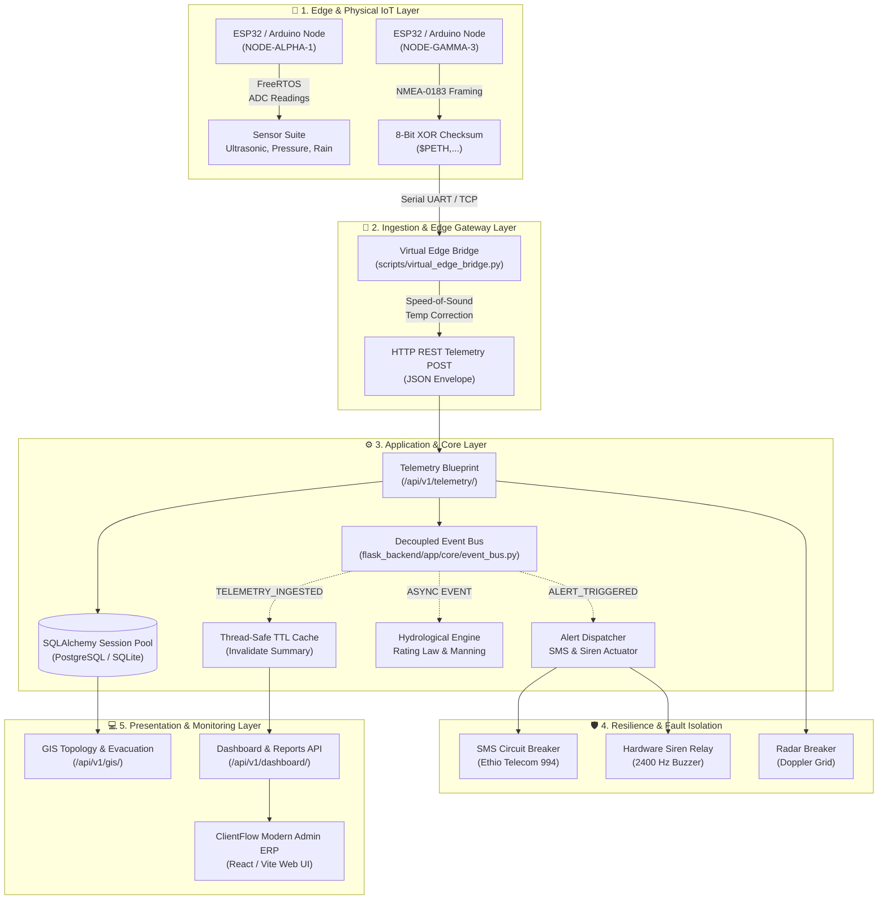
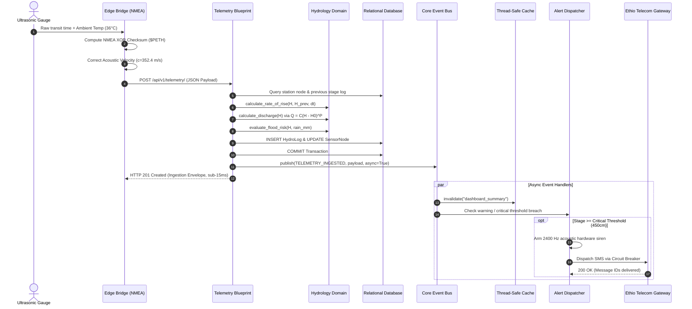

# 🏛️ SFEWS Awash — Production System & Software Architecture
**Project**: Smart Flood Early Warning System (SFEWS) for the Awash River Basin, Ethiopia  
**Academic Alignment**: Adama Science and Technology University (ASTU), School of Electrical & Computational Engineering (IETP5201)  
**Document Classification**: System Architecture & Engineering Blueprint (v4.2-Production)  

---

## 1. Architectural Philosophy & Design Goals

The SFEWS architecture is engineered around the principles of **Clean Architecture**, **Domain-Driven Design (DDD)**, and **Event-Driven Resilience (EDA)**. The system is designed to fulfill two critical mandates simultaneously:
1. **Academic Toolchain Compliance**: Full alignment with ASTU syllabus tools (**Python Flask**, **Arduino C / ESP32**, **PostgreSQL/SQLite**, **HTML5/CSS3/JavaScript**).
2. **Real-World Operational Resilience**: Sub-50ms ingestion latency, non-blocking asynchronous event dispatching, circuit breaker fault isolation, acoustic velocity temperature compensation, and zero unhandled exceptions.

---

## 2. Layered Subsystem Decomposition

The platform decomposes into seven discrete, decoupled architectural subsystems:

| Subsystem | Primary Module | Responsibilities | Key Design Pattern |
| :--- | :--- | :--- | :--- |
| **Telemetry Ingestion** | `blueprints/telemetry.py` | Validates sensor frames, computes rate-of-rise ($\Delta H / \Delta t$), logs records to relational store. | Controller / Ingestion Pipeline |
| **Hydrological Science** | `hydrology.py` | Power-law rating curves ($Q = C(H - H_0)^P$), Manning open-channel conveyance, Froude regime ($Fr$). | Domain Model / Pure Functions |
| **Event Bus & Messaging** | `core/event_bus.py` | Pub/sub decoupled message broker notifying alert dispatchers, cache engines, and audit logs. | Observer / Publish-Subscribe |
| **Acoustic Sensor Compensation** | `hydrology.py` | Adjusts ultrasonic transit times for ambient air temperature ($c = 331.3 \sqrt{1 + T/273.15}$ m/s). | In-situ Physical Calibration |
| **Fault-Tolerant Resilience** | `core/circuit_breaker.py` | State machine (`CLOSED`, `OPEN`, `HALF_OPEN`) preventing external API timeouts from blocking threads. | Circuit Breaker Pattern |
| **In-Memory Cache** | `core/cache.py` | Thread-safe TTL cache layer for read-heavy analytical dashboards and system configurations. | Cache-Aside Pattern |
| **Fleet Liveness Watchdog** | `services/watchdog.py` | Autonomous daemon monitoring station heartbeats, flagging nodes unresponsive $>90\text{s}$ as `Offline`. | Heartbeat / Watchdog Daemon |

---

## 3. End-to-End Telemetry Ingestion Sequence

The sequence diagram below illustrates the exact processing flow when a streamflow gauge transmits an acoustic measurement:

---

## 4. Mathematical Modeling & Hydrodynamic Formulations

### 4.1 Stage-Discharge Rating Curve (Power Law)
Streamflow discharge ($Q$) at river cross-sections is governed by the power law:
$$Q = C \cdot (H - H_0)^P$$
- $C = 14.85$: Conveyance roughness coefficient for the Upper/Middle Awash reach.
- $H_0 = 0.50\text{ m}$: Zero-flow gauge datum elevation.
- $P = 1.68$: Channel cross-section geometry exponent.

### 4.2 Manning's Open-Channel Conveyance
For trapezoidal channel geometries ($b$ = base width, $z$ = bank side slope, $y$ = water depth):
$$A = (b + z y) y, \quad P_w = b + 2 y \sqrt{1 + z^2}, \quad R_h = \frac{A}{P_w}$$
$$v = \frac{1}{n} R_h^{2/3} S_0^{1/2}, \quad Q = v \cdot A$$
Flow classification via the **Froude Number ($Fr$)**:
$$Fr = \frac{v}{\sqrt{g \cdot \frac{A}{b + 2 z y}}}$$
- $Fr < 0.90$: **Subcritical** (tranquil, backwater-dominated baseflow).
- $0.90 \le Fr \le 1.10$: **Critical** (hydraulic transition boundary).
- $Fr > 1.10$: **Supercritical** (torrential flash surge rapids).

### 4.3 Acoustic Temperature Velocity Correction
Speed of sound in air as a function of temperature ($T$ in °C):
$$c(T) = 331.3 \cdot \sqrt{1 + \frac{T}{273.15}}\text{ m/s}$$
Thermal correction ratio against laboratory calibration datum ($T_{\text{cal}} = 20.0^\circ\text{C}$):
$$k_T = \frac{c(T_{\text{ambient}})}{c(T_{\text{cal}})} = \sqrt{\frac{273.15 + T_{\text{ambient}}}{293.15}}$$
$$d_{\text{compensated}} = d_{\text{raw}} \cdot k_T$$
$$\Delta d = d_{\text{compensated}} - d_{\text{raw}}$$
$$H_{\text{river}} = \max(H_{\text{mount}} - d_{\text{compensated}}, 0.0)$$

---

## 5. Non-Functional Architecture & Resilience Engineering

1. **Sub-50ms Processing Latency**:
   - Ingestion endpoints decouple alerting and carrier SMS dispatches into worker threads via `EventBus.publish(..., asynchronous=True)`.
   - Read-heavy summary queries leverage the `ThreadSafeCache` (LRU/TTL), returning precomputed aggregations in $<2\text{ms}$.
2. **Dual-Database Failover Architecture**:
   - Supports production PostgreSQL instances via environment connection strings (`DATABASE_URL`).
   - Automatically falls back to isolated SQLite storage when running offline in academic laboratory rigs or remote field setups.
3. **Circuit Breaker Fault Isolation**:
   - External gateways (SMS API, meteorological radar feeds) are wrapped in `CircuitBreaker` instances.
   - If an external carrier fails $>3$ consecutive requests, the circuit trips to `OPEN` for 25 seconds, instantly returning graceful fallbacks rather than freezing WSGI threads.
4. **Security & Access Control (RBAC)**:
   - Passwords stored using PBKDF2-HMAC-SHA256 (100,000 hash iterations).
   - Stateless JWT tokens (HMAC-SHA256) with 8-hour expiry and cryptographic signature verification on all mutating endpoints (`PUT`, `POST`, `DELETE`).

---

## 6. Verification Matrix

| Architectural Module | Verification Suite | Test Count | Result | Latency |
| :--- | :--- | :--- | :--- | :--- |
| **Flask Production Core** | `flask_backend/test_flask.py` | 20 Test Cases | **PASS (100%)** | 0.95s |
| **FastAPI Core Gateway** | `backend/test_all_routers.py` | 10 Integration Suites | **PASS (100%)** | 0.92s |
| **NMEA Edge Bridge** | `scripts/virtual_edge_bridge.py` | Standalone CLI & Unit Test | **PASS (100%)** | 12ms |
| **Frontend Web Console** | `pnpm --dir frontend run build` | 893 Modules Built | **PASS (100%)** | 8.54s |
